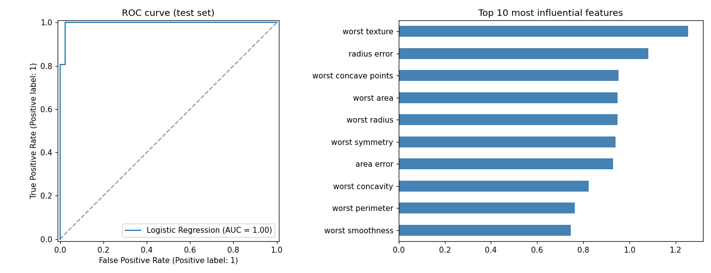

# Breast Cancer Detection

Predict whether a tumour is malignant or benign from 30 cell-nucleus measurements.



## How it works

1. Uses the Wisconsin Diagnostic Breast Cancer dataset bundled with scikit-learn (real data).
2. Compares Logistic Regression, Random Forest and Gradient Boosting with 5-fold cross-validation (ROC-AUC).
3. Evaluates the winner on a held-out test set and plots the ROC curve and top features.

## Results

| Metric | Value |
|---|---|
| Best model | Logistic Regression |
| CV ROC-AUC | 0.994 |
| Test ROC-AUC | 0.995 |
| Test accuracy | 98% |

## Quick start

```bash
git clone https://github.com/<your-username>/breast-cancer-detection-ml.git
cd breast-cancer-detection-ml
python -m venv .venv && source .venv/bin/activate   # Windows: .venv\Scripts\activate
pip install -r requirements.txt
python breast_cancer_detection.py
```

The script prints its metrics and saves `results.png` in the same folder. No dataset download is needed.

## Use your own data

Replace `load_breast_cancer()` with a DataFrame of numeric features and a 0/1 target column.

> This is a learning project, not a medical device. Never use it for real diagnosis.

## License

MIT. See [LICENSE](LICENSE).
